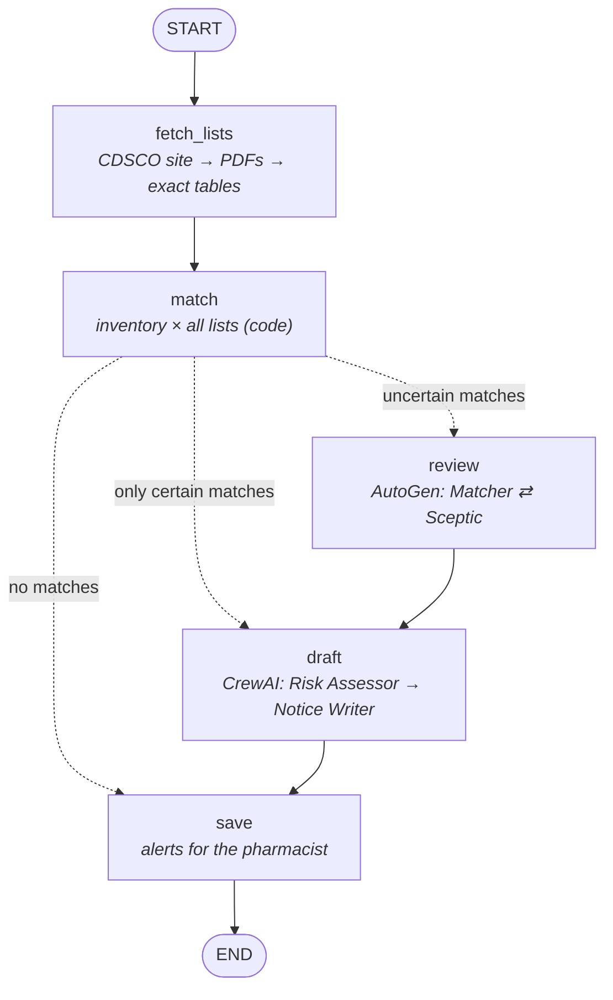

# MedAlert - substandard-medicine alert agent

Every month India's drug regulator **CDSCO** publishes lists of medicine batches
that **failed quality tests** ("Not of Standard Quality", NSQ) or were found to be
**spurious** (fake). The lists are public, but almost nobody checks them against
the medicines they actually hold.

**MedAlert does that automatically, every day:**

1. Finds new lists on the CDSCO website and downloads the PDFs.
2. Reads every entry exactly (drug, batch, maker, expiry, test failed).
3. Matches them against your **inventory**, whether that's a pharmacy, hospital
   store or family medicine box.
4. Has AI agents **review uncertain matches** and **draft each alert**: severity,
   actions, and a note to the supplier.
5. A **pharmacist confirms or dismisses** every alert. The agent never acts alone.

Anyone can also use **"Check a medicine"**: type the batch number from a strip or
box and see whether it's on a CDSCO list.

> Student project using public CDSCO data. It supports, and never replaces, a
> pharmacist's judgement. Always verify against the official list before acting.

---

## Three agent frameworks, one job each

| Framework | Job | Why |
|---|---|---|
| **LangGraph** (`pipeline.py`) | Orchestrates each check: fetch → match → review → draft → save, skipping the AI steps when they aren't needed | Explicit, testable control flow with conditional edges |
| **AutoGen** (`review_team.py`) | **Matcher vs Sceptic** debate on *uncertain* matches (same drug name, maker unclear) → `MATCH` / `NOT_MATCH` / `UNSURE` | A two-agent debate reduces false alarms *and* missed risks |
| **CrewAI** (`alert_crew.py`) | **Risk Assessor** + **Notice Writer** draft each alert (severity, recommended actions, supplier email) | Role-based crew producing one structured artifact (`AlertDraft`) |

Plain code, not AI, does everything that must be exact:
- **Reading the PDFs:** `nsq_parser.py`, using pdfplumber tables.
- **Matching:** `matching.py`, which handles brand names in brackets, strengths
  (500 mg ≠ 650 mg), "M/s." prefixes and addresses, and multi-batch cells.
- **A rule-based severity floor:** an injection that failed sterility is always
  CRITICAL, and the AI can't downgrade it.

AI is only used for the few matches found, so a daily check costs very few tokens.



### Match levels

| Level | Meaning | What the pharmacist does |
|---|---|---|
| **HIGH** (batch match) | Same batch number **and** same drug or maker | Quarantine and return the stock |
| **MEDIUM** (same product, check batch) | Same drug, strength and maker, different or unknown batch | Check the batch printed on the packs |
| **LOW** (possible, check pack) | Same drug name, maker not recorded or unclear. Reviewed by AutoGen. | Check the pack, then add maker and batch to the inventory |

A clearly different maker, or a different strength, is **not** a match.

### Severity
- **CRITICAL:** a sterile product (injection, infusion, eye drops) failed sterility,
  particulate or endotoxin tests, or the product is spurious.
- **HIGH:** failed assay, dissolution or content, so the dose may be wrong.
- **MODERATE:** appearance, weight or labelling defects.

---

## Run it on your computer (Windows PowerShell)

You need Python **3.10–3.13**.

```powershell
git clone https://github.com/eng25cs0577-ctrl/medicine_alert_agent.git
```

```powershell
cd medicine_alert_agent
```

```powershell
py -3.13 -m venv .venv
```

```powershell
.venv\Scripts\Activate.ps1
```

```powershell
python -m pip install -r requirements.txt
```

```powershell
copy .env.example .env
```

Optional: put a Groq key (https://console.groq.com/keys) in `.env` as
`LLM_API_KEY=...` to turn on the AI review and alert drafting. Without it,
everything works with rule-based drafts, and uncertain matches are marked for
manual checking.

```powershell
python -m uvicorn web:app --port 7860
```

Open http://localhost:7860, then:
1. **Inventory → Import CSV**, and choose `sample_data/inventory_sample.csv`.
2. **CDSCO lists → Upload a CDSCO PDF**, and choose `tests/fixtures/state_nsq_june_2025.pdf`
   (a real June 2025 list).
3. The **Alerts** page shows the matches.

The command line works too:

```powershell
python main.py inventory sample_data/inventory_sample.csv
```

```powershell
python main.py import tests/fixtures/cdsco_nsq_june_2025.pdf
```

```powershell
python main.py recheck
```

```powershell
python main.py alerts
```

---

## Put it online (free): Render + Neon + GitHub Actions

1. **Render** → New → Web Service → connect this repo. Language: **Docker**,
   Instance type: **Free**. Add these environment variables:
   - `LLM_API_KEY`: Groq key. Optional: `LLM_API_MODEL`, and the backup
     `LLM_FALLBACK_BASE_URL` / `LLM_FALLBACK_API_KEY` / `LLM_FALLBACK_MODEL`.
   - `ACCESS_CODE`: password for the pharmacist pages.
   - `CHECK_TOKEN`: a long random string, used by the daily scheduler.
   - `DATABASE_URL`: a **Neon** connection string (https://neon.tech, free), so
     the inventory and alerts are **permanent**.
2. **Daily check, even while the free server sleeps:** in this GitHub repo, go to
   **Settings → Secrets and variables → Actions** and add the secrets `SITE_URL`
   (your Render address) and `CHECK_TOKEN` (the same value as on Render).
   `.github/workflows/daily-check.yml` then wakes the site and starts a check
   every day at 10:00 IST. You can also start it from **Actions → Run workflow**.
3. **If the CDSCO site blocks Render's servers**, which can happen because the
   servers are outside India, the check logs "could not reach CDSCO". Download
   the PDF from https://cdsco.gov.in/opencms/opencms/en/Alerts/ and use
   **CDSCO lists → Upload a CDSCO PDF**. If you know the address of the newer
   "NSQ Alerts" page, set it as `CDSCO_NSQ_URL`.

---

## Tests (offline, no AI key or internet needed)

```powershell
pip install -r requirements-dev.txt
```

```powershell
pytest -q
```

The tests use two **real CDSCO PDFs** (June 2025: 130 state-lab entries and 55
central-lab entries) in `tests/fixtures/`. They cover:
- exact parsing of both PDFs,
- matching rules,
- the AutoGen debate (with scripted model replies),
- CrewAI drafting,
- the full website flow, the access code and the scheduler token,
- behaviour when the CDSCO site is blocked.

## Project layout

```text
web.py             FastAPI website + API (public search, pharmacist pages, scheduler endpoint)
static/index.html  Single-page UI: overview, alerts, inventory, lists, check a medicine, activity
pipeline.py        LangGraph orchestrator; import_pdf_bytes(); run_check()
review_team.py     AutoGen Matcher vs Sceptic review of uncertain matches
alert_crew.py      CrewAI Risk Assessor + Notice Writer; rule-based severity and draft
nsq_parser.py      Exact reading of CDSCO NSQ/spurious PDFs (pdfplumber)
matching.py        Inventory vs list matching (names, strengths, makers, batches)
cdsco.py           Finds and downloads new lists from the CDSCO Alerts page
storage.py         PostgreSQL (DATABASE_URL) or SQLite: lists, entries, inventory, alerts, runs
config.py          Shared settings, logging, retries, backup-provider switch
models.py          Pydantic contracts shared by all parts
main.py            Command line
```
